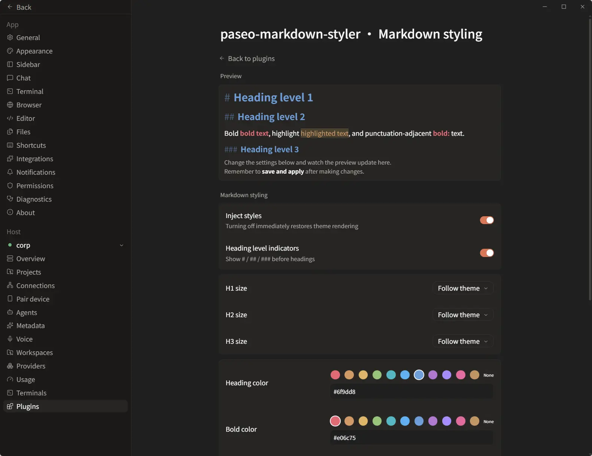

# Markdown Styler



A [Paseo](https://paseo.sh) plugin that adjusts how rendered Markdown looks in the Paseo app — heading sizes, bold and highlight colors, optional heading level indicators and custom CSS — without replacing the built-in renderer. The settings page includes a live preview rendered through Paseo's own Markdown pipeline.

## How it differs from chat-replacement plugins

Plugins such as Beautiful Chat or Better Paseo **replace** the built-in chat renderer with their own, so every upstream rendering improvement must be re-implemented by the plugin before it appears. Markdown Styler takes the opposite approach: it **keeps Paseo's native chat view as the renderer** and only injects a stylesheet on top of it.

In practice:

- New Paseo features land in your chat the moment you update Paseo — Mermaid diagrams, workspace file links and images, native selection, tables, task lists, admonitions, timeline refinements — nothing to wait for and nothing to fall back on.
- No parallel Markdown pipeline to maintain, so the plugin cannot lag behind Paseo releases or lose compatibility with them.
- The cost: styling is limited to what CSS can express over the native output. If you want a fully different chat layout (compact tool rows, custom cards, a tasks board), a replacement plugin like Beautiful Chat is the right tool; if you want **your** Markdown styling to always track the latest Paseo, this is the lighter one.

## Install

```bash
paseo plugin add Moyf/paseo-markdown-styler
```

Or install from a local checkout:

```bash
paseo plugin install /absolute/path/to/paseo-markdown-styler
```

## Development

```bash
npm install
npm run typecheck
paseo plugin reload paseo-markdown-styler
```

The plugin is client-side only: `index.server.ts` exists to persist settings and serve them to clients. CSS injection applies on desktop and browser clients; the ==highlight== syntax requires the Moyf Paseo build's parser support and is detected automatically.
